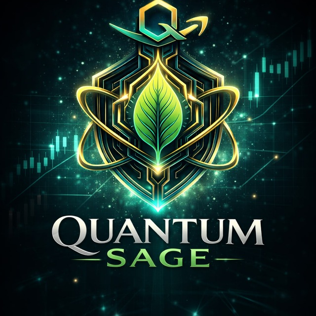
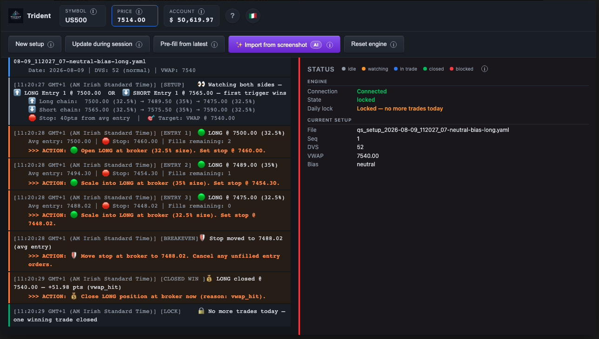

# Quantum Sage (QS)

Quantum Sage is an umbrella for trading strategies that process discretionary analysis and generate tradeable signals.

## Strategies

### Trident

Trident is the first strategy under the Quantum Sage umbrella. It implements an intraday mean-reversion system for S&P 500 instruments (ES futures, CFDs, or options).

For more information, see the [Trident Product Requirements Document (PRD)](trident/docs/PRD.md) and the [Architecture](trident/docs/ARCHITECTURE.md).

Application Screenshot :

**[More Screenshots - Full Acceptance Report →](https://github.com/walshe/quantum-sage/raw/main/trident/impl/nodejs/acceptance-results/latest/report.html)** *(GitHub won't render this HTML inline, so right-click the link → save the file, then open it locally in your browser)*
